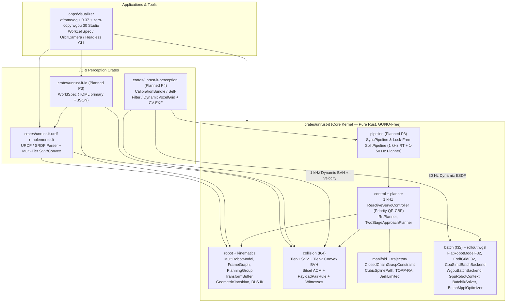

# `unrust-it` Architecture (Current & Planned)

This document describes the architectural foundations of `unrust-it`, the current workspace implementation through **Phase 2D**, concrete friction points audited in Phase 2, and the planned architecture for **Phases 3–5** (declarative world configuration, sensors & calibration, real-time dual-rate pipeline, mobile manipulators, and mesh/CAD support).

---

## 1. Core Architectural Invariants

1. **Strict Crate Boundary Between Kernel, I/O, Perception, and GUI**
   - `crates/unrust-it` contains pure math, kinematics, collision geometry, constraint manifolds, trajectory parameterization, 1 kHz control, global/local planning, and SIMD/GPU batched rollout kernels. It depends on **no GUI, windowing, file-format, or async-runtime crates**.
   - Parsing, world serialization (`unrust-it-urdf`, planned `unrust-it-io`), sensor/perception ingestion (planned `unrust-it-perception`), and visual tools (`apps/visualizer`) depend *downward* on `unrust-it`.

2. **Dual-Precision Compute Architecture**
   - **`f64` Exact Layer** (`nalgebra 0.34` + `parry3d-f64 0.26` aliased as `parry3d`): Used for exact forward kinematics, $6 \times N_{\text{dof}}$ analytical geometric Jacobians, screw-axis distance projections, GJK/EPA signed distances, Newton-Raphson manifold projections, TOPP-RA time parameterization, and 1 kHz CBF QP reactive control.
   - **`f32` Batched Rollout Layer** (`wide::f32x8` + `rayon` + `wgpu 30` WGSL compute shaders): Evaluates $N = B \times H$ configurations in one branchless dispatch using flattened C-ABI structs (`FlatRobotModelF32`), sphere trees (`FlatLinkSphereF32`), self-pair checks (`FlatSpherePairF32`), and trilinear 3D Euclidean Signed Distance Fields (`EsdfGridF32`).

3. **Zero-Allocation Hot Paths via Immutable Topology vs. Thread Scratchpads**
   - Scene definitions (`MultiRobotModel`, `CollisionEnvironment`) are immutable and `Send + Sync` during planning and control ticks.
   - Mutable scratch memory is segregated per thread or control loop into `TransformBuffer`, `CollisionWorkspace`, and `ReactiveServoController`.

4. **Multi-Tier Geometric Fidelity & Per-Pair Rules**
   - **Tier 1 (`GeometryTier::AnalyticSsv`)**: SoA SIMD sphere/capsule envelopes (`BoundingSphere`, `LinkCapsule`, `WorldSphereSoA`) for high-throughput pruning and GPU/SIMD batching.
   - **Tier 2 (`GeometryTier::Convex`)**: Exact `parry3d-f64` convex primitives attached to links, obstacles, and multi-shape `AttachedPayload`s.
   - **Allowed Collision Matrix (ACM) & Compound Payloads**: Hardware-`CTZ` bitset `AllowedCollisionMatrix` with `CollisionRule::{Enabled, CustomMargin(f64), DisabledAdjacent, DisabledNeverColliding, DisabledDefault, DisabledDynamic}`, plus `PayloadPairRule` supporting asymmetric rules (e.g., 40 mm body margin vs. 3–4 mm tool-to-workpiece approach margin) and per-tool `touch_links` self-collision exemptions.

---

## 2. High-Level System Architecture (Current & Planned)



---

## 3. Current Workspace Architecture (Through Phase 2D)

### 3.1 Core Kernel (`crates/unrust-it`)

| Module | Precision | Key Responsibilities & Components |
| :--- | :---: | :--- |
| [`robot`](../crates/unrust-it/src/robot.rs) | `f64` | Strongly typed IDs (`RobotId`, `LinkId`, `JointId`, `FrameId`, `ObstacleId`, `PayloadId`), `JointType` (`Fixed`, `Revolute`, `Continuous`, `Prismatic`), `FrameGraph`, `PlanningGroup` (with `.union()`), `AttachedPayload`, and `MultiRobotModel` with precomputed ancestor DOF bitmasks and Lipschitz lever-arm bounds $L_{i,k}$. |
| [`kinematics`](../crates/unrust-it/src/kinematics.rs) | `f64` | Single-pass topological FK in `TransformBuffer`, analytical $6 \times N_{\text{dof}}$ `geometric_jacobian`, allocation-free screw-axis projection (`accumulate_point_jacobian_projection`), and multi-target DLS IK (`solve_ik_dls`). |
| [`collision`](../crates/unrust-it/src/collision.rs) | `f64` | `CollisionEnvironment` + pre-allocated `CollisionWorkspace`: Tier-1 `f64x4` `WorldSphereSoA` / `LinkCapsule`, Tier-2 `parry3d-f64` convex shapes, hardware-`CTZ` bitset `AllowedCollisionMatrix`, obstacle BVH with dynamic `set_obstacle_pose`, Lipschitz-bounded continuous checking (`is_segment_collision_free`), and `SignedDistanceWitness::compute_distance_jacobian`. |
| [`manifold`](../crates/unrust-it/src/manifold.rs) | `f64` | `ConstraintManifold` trait and `ClosedChainGraspConstraint` with Newton-Raphson configuration projection and constraint Jacobian evaluation. |
| [`trajectory`](../crates/unrust-it/src/trajectory.rs) | `f64` | $C^2$ `CubicSplinePath`, time-optimal `ToppraTrajectory`, and online `JerkLimitedTrajectory` under velocity/acceleration/jerk limits. |
| [`control`](../crates/unrust-it/src/control.rs) | `f64` | 1 kHz `ReactiveServoController`: multi-arm prioritized differential IK, closed-chain stabilization, tangential curl deadlock breaking, velocity-damper joint bounds, and Dykstra-projected QP CBF safety inequalities. |
| [`planner`](../crates/unrust-it/src/planner.rs) | `f64` / `f32` | `RrtPlanner` (bidirectional flat-arena RRT-Connect with shortcutting and `Target::MultiPose`) and `TwoStageApproachPlanner` (Stage 1 global MPPI/RRT + Stage 2 exact `GeometryTier::Convex` CBF convergence). |
| [`batch`](../crates/unrust-it/src/batch.rs) + [`rollout.wgsl`](../crates/unrust-it/src/rollout.wgsl) | `f32` | `FlatRobotModelF32`, `EsdfGridF32` (with `clear`, `carve_shape`, `carve_collision_environment`), `CpuSimdBatchBackend` (`wide::f32x8` + `rayon`), `WgpuBatchBackend` (`wgpu 30`, <= 8 storage buffers for WebGPU parity), persistent `GpuRobotContext` (with `update_esdf`), `BatchIkSolver`, and `BatchMppiOptimizer` (with `optimize_with_trace`). |

### 3.2 URDF/SRDF Ingestion (`crates/unrust-it-urdf`)

- Parses single- or N-arm URDF descriptions into a shared `MultiRobotModel` + `CollisionEnvironment` with namespace `prefix` and arbitrary 6-DOF base mounting transforms (`load_urdf_str`, `load_urdf_file`, `add_urdf_to_scene`, `add_urdf_file_to_scene`).
- Parses MoveIt SRDF (`apply_srdf_str`, `apply_srdf_file`) to register `<group>`, `<group_state>`, and `<disable_collisions>`.
- Automatically synthesizes Tier-1 sphere trees and capsule approximations alongside Tier-2 `parry3d` convex collision shapes.
- Includes reusable `presets` (`ARM_4DOF_URDF`/`SRDF`, `ARM_6DOF_URDF`/`SRDF`) shared across tests and Studio scenes.

### 3.3 Desktop Engineering Studio (`apps/visualizer`)

- **Declarative Scene Compiler (`src/scene/`)**: `WorkcellSpec` compiles deterministically into an immutable `BuiltWorkcell` (`MultiRobotModel`, `CollisionEnvironment`, `FlatRobotModelF32`, `EsdfGridF32`), evaluates planners (`eval.rs`), and provides 5 built-in N-arm presets (`presets.rs`).
- **Pure-`wgpu 30` 3D Renderer (`src/render/`)**: GUI-free `SceneRenderer` with `OrbitCamera` (with `screen_ray` picking), instanced `TypedShape` extraction (`extract_render_scene_with_highlights`), `solid.wgsl` / `lines.wgsl` / `esdf_slice.wgsl`, and `OffscreenViewport` for headless CI validation.
- **Native Desktop Shell (`src/gui/`)**: `eframe` / `egui 0.37` + `egui-wgpu 0.37` Studio integrating zero-copy native `Rgba8Unorm` texture presentation (`GpuViewportBridge`), direct-ownership `StudioState`, background `PlannerWorker` with latest-generation coalescing, 4 interactive `egui_plot 0.38` charts (plus pure-Rust RGBA8 charts in `plots.rs`), 3D raycast picking, frozen-header ACM Matrix with live $d(t)$ and filtering, Obstacle/Tool/Touch-Link inspectors, and `Targets & IK` (32-seed `BatchIkSolver` preview).
- **Headless Exports**: `--export-html`, `--export-json`, and `--serve` run without initializing any GUI or windowing backend (also supported under `--no-default-features`).

---

## 4. Phase 2 Engineering Audit (Friction Points Targeted in Phase 3)

Before building external world schemas and sensor pipelines, an architectural audit identified five core friction points to resolve cleanly in Phase 3:

1. **Split-Brain Scene Updates**: Currently callers mutate `MultiRobotModel`, `CollisionEnvironment`, and `EsdfGridF32` independently; adding or moving an obstacle does not automatically re-carve `EsdfGridF32`.
2. **Remaining 1 kHz Heap Allocations**: `ReactiveServoController::step()` allocates temporary `DVector`/`DMatrix` instances, `canonical_payload_pair()` allocates `String` keys per lookup, and `ToppraTrajectory::sample(t)` allocates output `Vec<f64>`s.
3. **Trajectory Safety Filtering**: `ReactiveServoController` currently accepts task-space Cartesian targets (`ServoTarget`); adding `ServoTarget::JointReference { q_ref, dq_ref, kp }` enables using it directly as a 1 kHz CBF safety filter tracking any `ToppraTrajectory`.
4. **Resident GPU Context Wiring**: `BatchMppiOptimizer` and `BatchIkSolver` currently dispatch through transient buffer allocations in `WgpuBatchBackend` rather than reusing `GpuRobotContext`'s persistent resident storage buffers (`forward_kinematics_resident`, `collision_cost_resident`).
5. **Subgroup Masked Planning**: `PlanningGroup` already supports subset DOF extraction/injection, but `RrtPlanner` and `TwoStageApproachPlanner` still operate across all `model.dof()` joints simultaneously.

---

## 5. Planned Architecture (Phases 3–5)

### 5.1 Unified World Scene & Declarative `WorldSpec` (`crates/unrust-it-io`)

- **`WorldScene` Owner (Core)**: Manages synchronized static & named dynamic obstacles (`ObstacleHandle`), automatic BVH rebuilds, and dirty-region ESDF updates.
- **Dual-Format Serialization (`serde`)**:
  - Core kernel stays `serde`-free behind optional config/spec serialization (or `unrust-it-io` owns schema structs compiling into `MultiRobotModel` + `CollisionEnvironment` + `EsdfGridF32` + `CalibrationBundle`).
  - **TOML (`.unrust.toml`)** as the primary human-authored format in Git (clean sections for `[[robots]]`, `[[payloads]]`, `[[obstacles]]`, `[[sensors]]`, `[[collision.pair_rules]]`, `[esdf]`, `[planner]`).
  - **JSON (`.unrust.json`)** automatically supported from the exact same `WorldSpec` structs for IPC, web/desktop Studio interchange, and runtime snapshots.
  - Studio's `WorkcellSpec` will share or map directly to `WorldSpec`, enabling seamless Open/Save in the desktop UI.
- **Per-Robot Trajectory & Frame/Subframe Import (`Format TBD`)**:
  - **Core Requirement**: Import an ordered list of trajectories per robot (`robot_uid`), where each trajectory contains a sequence of **frames** (named keyframes/reference poses — either Cartesian $SE(3)$ poses relative to `world`/workpiece/base frames or joint-space waypoints — with optional timing, velocity, and blend metadata) and nested **subframes** (local child transforms such as approach/retract/tool-tip offsets or dense intermediate micro-frames relative to a parent frame).
  - **Format Status**: Exact file schema and container format are **to be decided (TBD)** during Milestone 3C design — primary candidates are **JSON** and **TOML** (consistent with `WorldSpec` in `crates/unrust-it-io`), with optional CSV/YAML/industrial adapters.
  - **Execution Modes**:
    1. *Cartesian Frame/Subframe Planning*: Resolve the frame -> subframe hierarchy into `TaskPose` / `ApproachTarget` sequences and plan collision-free multi-arm trajectories (`BatchIkSolver` + `TwoStageApproachPlanner` / MPPI / RRT + TOPP-RA).
    2. *Joint-Space Replay & Safety Verification/Filtering*: Evaluate exact `GeometryTier::Convex` clearances & ACM rules across imported frames/subframes, and optionally filter multi-arm interference live at 1 kHz via `ServoTarget::JointReference` (Milestone 3A).
  - **Desktop Studio UI (`apps/visualizer`)**: Add a dedicated **`Import Trajectories`** button in the Top Toolbar / Planner panel to load per-robot trajectory lists into the active workcell for 3D preview, ACM/witness clearance inspection, and CBF-filtered replanning.

### 5.2 Sensors, Calibration & Real-Time Dynamic Fusion (`crates/unrust-it-perception`)

Designed to ingest physical sensor streams with **zero dynamic allocation** in the hot path while respecting both `f32` GPU/SIMD batching and `f64` 1 kHz CBF safety guarantees:

1. **`CalibrationBundle` Ingestion & Frame Mounting**:
   - Parsers for **TOML**, **JSON**, and **OpenCV/ROS XML** (reusing `roxmltree`), plus optional YAML.
   - Intrinsics for Pinhole + Brown-Conrady / Kannala-Brandt distortion, depth scale/noise models, 2D/3D LiDAR beam elevation/azimuth tables, Radar FOV/Doppler resolution, and inter-sensor latency offset `dt_offset_s`.
   - SE(3) extrinsics mounted directly into `MultiRobotModel::frame_graph` as **Eye-to-Hand** (world/fixture frame) or **Eye-in-Hand** (moving robot link frame — automatically transformed via `TransformBuffer::forward_kinematics` and compensated using link velocities from `geometric_jacobian`).
   - Load-time precomputation of SoA `f32x8` undistortion LUTs (`RayLutF32`) so per-pixel projection uses only 2 multiplies per depth sample.

2. **Zero-Copy Observations & Ego-Motion Compensation**:
   - Borrowed `SensorObservation<'a>` views for **RGB-D** (`DepthU16` / `DepthF32` / `OrganizedCloud`), **2D/3D LiDAR** (per-point sweep deskewing interpolated across a 256-slot 1 kHz `JointStateHistory`), and **mmWave Radar** (eye-in-hand ego-motion radial Doppler compensation:
     $$v_{r,\text{world}} = v_{r,\text{meas}} + \hat{\mathbf{u}}_w \cdot J_v(q)\dot{q}$$
     where $\hat{\mathbf{u}}_w$ is the world unit ray and $J_v(q)$ is the sensor frame's translational Jacobian).

3. **Branchless `f32x8` SIMD Self-Filter**:
   - 3-stage filter (Super-AABB -> padded link capsules -> padded compound/payload spheres, inflated by `lever_arm_bound * |dq| * dt_jitter + calib_margin`).
   - Tags points falling on robot bodies as `FreeOnlyHitRobot` so raycasting clears free space up to the arm without carving false free space *behind* self-occluding links.

4. **Dual-Layer Dynamic World Fusion**:
   - **30 Hz `f32` MPPI Layer**: `i8` log-odds `DynamicVoxelGrid` with deduplicated 3D DDA free-space raycasting + TTL decay + Radar velocity-swept predictive capsules -> parallel Felzenszwalb-Huttenlocher 3D Euclidean Distance Transform (or optional WGSL `JFA+1`) -> `min(static_esdf, dyn_esdf)` uploaded via `GpuRobotContext::update_esdf`.
   - **1 kHz `f64` CBF Layer**: Near-field ROI voxel clustering ($\le 48$ convex primitives) + 6-state Constant-Velocity EKF (`CV-EKF`) multi-target Radar/LiDAR tracker published via a lock-free triple buffer into `CollisionEnvironment`, feeding a **velocity-compensated CBF inequality**:
     $$J_{\text{dist}}(q)\,\dot{q} \ge -\gamma\,(d - d_{\min}) + \max\!\bigl(0,\, \mathbf{n}_{\text{world}} \cdot \dot{\mathbf{x}}_{\text{obs}}\bigr) + \sigma_{v,\text{obs}}$$

### 5.3 Composable Dual-Rate Pipeline (`unrust_it::pipeline`)

While direct use of low-level structs (`TransformBuffer`, `CollisionWorkspace`, `ReactiveServoController`) remains first-class, `unrust_it::pipeline` will add trait-based composable execution without requiring `tokio`:

```text
PerceptionIngest ─▶ WorldScene ─▶ TrajectoryMonitor ─▶ GlobalPlannerStage ─▶ TimeParameterizerStage ─▶ ReactiveSafetyFilter ─▶ CommandSink
```

- **`SyncPipeline::tick(dt)`**: Deterministic single-thread runner for unit tests, discrete-time simulation, and Phase 2D Studio playback.
- **`SplitPipeline`**: Lock-free `ArcSwap` / triple-buffer bridge isolating a **1 kHz hard-RT safety thread** (trajectory sampling + priority QP-CBF, strictly zero-alloc) from **1–50 Hz background planner & perception workers** (supporting mid-flight horizon invalidation checks and hot-swappable global planners).

### 5.4 Mobile Robots & Mobile Manipulators (`nq` / `nv` Separation)

To support mobile bases and mobile manipulators cleanly within the exact same tree and zero-alloc invariants:

- Decouple **configuration vector size ($n_q$)** from **tangent velocity dimension ($n_v$)** per joint:
  - Fixed-arm joints (`Revolute`, `Continuous`, `Prismatic`): $n_q = 1, n_v = 1$.
  - `JointType::Planar { drive: Holonomic | DiffDrive | Ackermann }`: $n_q = 3$ (`[x, y, yaw]`), with body-frame tangent $n_v = 3$ (`Holonomic`) or $n_v = 2$ (`[v_fwd, wz]` for `DiffDrive` / `Ackermann` — making non-holonomic zero-lateral-slip structurally exact in IK, manifolds, and CBF Jacobians, while `Ackermann` adds two linear steering curvature bounds to the existing Dykstra QP).
  - `JointType::Floating`: $n_q = 7$ (translation + quaternion), $n_v = 6$ body spatial twist.
- Precompute per-tangent-DOF world screw columns (`dof_origin_w`, `dof_linear_w`, `dof_angular_w`) inside `TransformBuffer` during one FK pass, keeping Jacobian assembly branchless for fixed arms and mobile bases alike.
- In `rollout.wgsl`: introduce `JOINT_KIND_PLANAR_SE2 = 3` and `JOINT_KIND_FLOATING_SE3 = 4` within the existing 64-byte `FlatJointF32` layout, and raise the shader link array cap from `64` to `128`.
