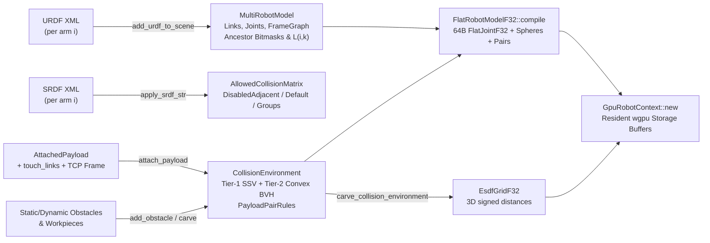
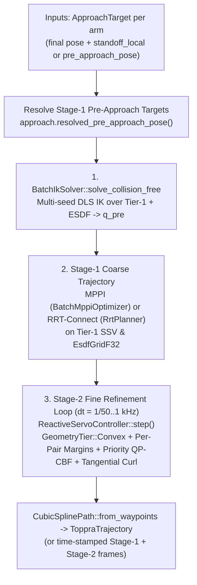
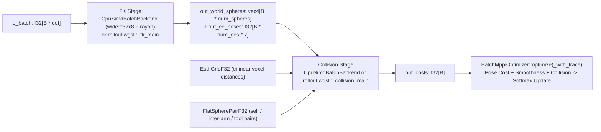
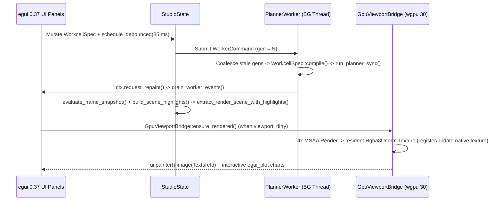

# `unrust-it` Code Map & Execution Flows

This reference maps every file in the workspace and walks through the five primary runtime data & execution paths from API boundary down to SIMD / WGSL / QP math.

---

## 1. Repository & Module Inventory

### 1.1 `crates/unrust-it` (Core Kernel)

| File | Responsibility & Key Types | Thread Safety / Hot-Path Notes |
| :--- | :--- | :--- |
| [`src/lib.rs`](../crates/unrust-it/src/lib.rs) | Crate documentation, module tree, public re-exports, doc quick-start | Pure Rust; `gpu` feature on by default |
| [`src/robot.rs`](../crates/unrust-it/src/robot.rs) | IDs (`RobotId`, `LinkId`, `JointId`, `FrameId`, `ObstacleId`, `PayloadId`), `JointType`, `JointSpec`, `LinkSpec`, `FrameGraph`, `PlanningGroup`, `MultiRobotModel`, `Robot`, `KinodynamicLimits` | Immutable `Send + Sync` after construction; stores ancestor DOF bitmasks (`Vec<u64>`) & lever-arm bounds $L_{i,k}$ |
| [`src/kinematics.rs`](../crates/unrust-it/src/kinematics.rs) | `TransformBuffer`, `MultiRobotModel::{forward_kinematics, geometric_jacobian, compute_point_and_angular_jacobian_on_link, accumulate_point_jacobian_projection, solve_ik_dls}` | Pre-allocated per-thread `TransformBuffer`; zero-alloc FK & screw projection |
| [`src/collision.rs`](../crates/unrust-it/src/collision.rs) | `GeometryTier`, `LinkGeometry`, `WorldSphereSoA`, `LinkCapsule`, `AttachedPayload`, `AllowedCollisionMatrix`, `CollisionEnvironment`, `CollisionWorkspace`, `SignedDistanceWitness` | Hardware-`CTZ` bitset ACM, `parry3d` BVH broad-phase, `f64x4` SIMD SSV spheres, Lipschitz `is_segment_collision_free` |
| [`src/manifold.rs`](../crates/unrust-it/src/manifold.rs) | `ConstraintManifold`, `ClosedChainGraspConstraint` | Evaluates holonomic loop closure $F(q) = \mathbf{0}$, constraint Jacobian, and Newton-Raphson projection |
| [`src/trajectory.rs`](../crates/unrust-it/src/trajectory.rs) | `TrajectorySample`, `CubicSplinePath`, `ToppraTrajectory`, `JerkLimitedTrajectory` | $C^2$ cubic splines + velocity/accel/jerk-bounded time parameterization |
| [`src/control.rs`](../crates/unrust-it/src/control.rs) | `ServoTarget`, `ReactiveServoConfig`, `ReactiveServoController::step` | 1 kHz differential IK + closed-chain stabilization + priority-weighted Dykstra QP-CBF + tangential curl |
| [`src/planner.rs`](../crates/unrust-it/src/planner.rs) | `Target`, `PathPlanner`, `RrtPlanner`, `ApproachTarget`, `CoarsePlannerMode`, `TwoStagePlanConfig`, `TwoStageApproachPlanner` | Flat-arena bidirectional RRT-Connect + shortcutting, and Stage-1/Stage-2 close-proximity planner |
| [`src/batch.rs`](../crates/unrust-it/src/batch.rs) | `FlatRobotModelF32`, `EsdfGridF32`, `BatchRolloutBackend`, `CpuSimdBatchBackend`, `WgpuBatchBackend`, `GpuRobotContext`, `BatchIkSolver`, `BatchMppiOptimizer` | $B \times H$ evaluation via `wide::f32x8` + `rayon` and persistent `wgpu` storage buffers |
| [`src/rollout.wgsl`](../crates/unrust-it/src/rollout.wgsl) | Compute shaders `fk_main` and `collision_main` (`@workgroup_size(64)`) | WebGPU-portable: strictly $\le 8$ storage buffers (`64`-link static local arrays) |

### 1.2 `crates/unrust-it-urdf` (URDF & SRDF Loader)

| File | Responsibility & Key Types |
| :--- | :--- |
| [`src/lib.rs`](../crates/unrust-it-urdf/src/lib.rs) | `load_urdf_str`, `load_urdf_file`, `add_urdf_to_scene`, `add_urdf_file_to_scene`, `apply_srdf_str`, `apply_srdf_file`, `UrdfRobotHandle`, `SrdfData`, `UrdfError`, and `presets::{ARM_4DOF_URDF, ARM_4DOF_SRDF, ARM_6DOF_URDF, ARM_6DOF_SRDF}` |
| [`tests/three_arm_proximity.rs`](../crates/unrust-it-urdf/tests/three_arm_proximity.rs) | End-to-end 3-arm close-proximity convergence & deadlock-free crossing integration tests |

### 1.3 `apps/visualizer` (Desktop Studio & Headless Exporter)

| File | Responsibility |
| :--- | :--- |
| [`src/main.rs`](../apps/visualizer/src/main.rs) | CLI argument router (`--export-html`, `--export-json`, `--serve` headless vs `gui::run_gui()`) |
| [`src/lib.rs`](../apps/visualizer/src/lib.rs) | Legacy 3-scenario generator (`VisualizerScenario`), JSON serializer, and standalone HTML/Canvas renderer |
| [`src/scene/spec.rs`](../apps/visualizer/src/scene/spec.rs) | Declarative `WorkcellSpec`, `ArmSpec`, `ToolPreset`, `CustomToolSpec`, `ObstacleSpec`, `CollisionRulesSpec`, `EsdfSpec`, `PlannerSpec`, `DirtyFlags` |
| [`src/scene/compile.rs`](../apps/visualizer/src/scene/compile.rs) | Compiles `WorkcellSpec` -> `BuiltWorkcell` (`MultiRobotModel`, `CollisionEnvironment`, `FlatRobotModelF32`, carved `EsdfGridF32`) |
| [`src/scene/presets.rs`](../apps/visualizer/src/scene/presets.rs) | 5 built-in N-arm preset scenarios (`PresetId`) |
| [`src/scene/eval.rs`](../apps/visualizer/src/scene/eval.rs) | Synchronizes planner execution (`run_planner_sync` -> `PlaybackTrajectory`) and zero-alloc `evaluate_frame_snapshot` |
| [`src/worker.rs`](../apps/visualizer/src/worker.rs) | Background `PlannerWorker` thread with atomic latest-generation coalescing & cancellation |
| [`src/plots.rs`](../apps/visualizer/src/plots.rs) | CPU RGBA8 time-series chart rasterizers (`min clearance`, `tool clearance`, `pose error`, `joint velocities`) |
| [`src/render/mod.rs`](../apps/visualizer/src/render/mod.rs) | Pure-`wgpu 30` `SceneRenderer` (4x MSAA, depth pass, instanced `solid.wgsl`, `lines.wgsl`, `esdf_slice.wgsl`) |
| [`src/render/extract.rs`](../apps/visualizer/src/render/extract.rs) | Extracts instanced `RenderSceneData`, `pick_entity_along_ray`, `SceneHighlights`, and ESDF 2D heatmap slices |
| [`src/render/camera.rs`](../apps/visualizer/src/render/camera.rs) & [`meshes.rs`](../apps/visualizer/src/render/meshes.rs) | Z-up `OrbitCamera` (`screen_ray` + view/proj) and unit sphere/box/cylinder/capsule/cone/rod meshes |
| [`src/render/offscreen.rs`](../apps/visualizer/src/render/offscreen.rs) | `OffscreenViewport` rendering `wgpu 30` scenes to RGBA8 buffers for headless CI tests |
| [`src/gui/viewport.rs`](../apps/visualizer/src/gui/viewport.rs) | `GpuViewportBridge`: zero-copy `egui-wgpu 0.37` (`Rgba8Unorm` `register_native_texture` / `update_egui_texture_from_wgpu_texture`) presentation bridge |
| [`src/gui/state.rs`](../apps/visualizer/src/gui/state.rs) | Direct-ownership `StudioState` holding `WorkcellSpec`, `PlannerWorker`, debounced replanning, playback timers, 3D ray picking, ACM filtering, and `Targets & IK` preview |
| [`src/gui/panels/`](../apps/visualizer/src/gui/panels/mod.rs) & [`src/gui/mod.rs`](../apps/visualizer/src/gui/mod.rs) | `eframe::App` shell (`top_toolbar`, `scene_panel`, `viewport_panel`, `acm_panel`, `planner_panel`, `timeline_dock` with `egui_plot 0.38`) |

---

## 2. Execution Flow Traces

### Flow 1 — Workcell Construction & Model Compilation

**Step-by-step code path**:
1. `add_urdf_to_scene()` parses XML with `roxmltree`, verifies tree connectivity, inserts `prefix`-namespaced links/joints into `MultiRobotModel` in topological order via `add_link_and_joint()`, and converts every `<collision>` primitive (box, sphere, Y/Z-aligned cylinder, capsule) into both Tier-1 `BoundingSphere`/`LinkCapsule` and Tier-2 `parry3d` `SharedShape` inside `CollisionEnvironment`.
2. Inside `MultiRobotModel::add_link_and_joint()`, ancestor bitmasks (`ancestor_dofs`) and conservative Lipschitz lever-arm bounds $L_{i,k}$ (used later by `max_link_displacement` during segment checking) are recomputed across topological descendants.
3. `apply_srdf_str()` merges adjacent and explicitly `<disable_collisions>` pairs into `AllowedCollisionMatrix`, stores `<group_state>` presets, and registers named `PlanningGroup`s.
4. Callers attach compound end-of-arm tools with `env.attach_payload(...)` (setting `touch_links` so the wrist links carrying the gripper are exempt from tool-self checks), add fixed TCP frames (`model.add_fixed_frame`), and configure `set_payload_pair_margin` / `set_payload_obstacle_margin`.
5. For `f32` batch evaluation, `FlatRobotModelF32::compile(&model, &env)` packs topological joints into C-ABI `FlatJointF32`, converts active convex/payload geometries into `FlatLinkSphereF32` (marking payloads with `SPHERE_FLAG_PAYLOAD`), and compiles active link/payload/self pairs into `FlatSpherePairF32`. `EsdfGridF32::carve_collision_environment(&env)` populates the voxel grid. Optionally, `GpuRobotContext::new(...)` uploads these once into persistent GPU buffers.

---

### Flow 2 — Two-Stage Close-Proximity Planning (`TwoStageApproachPlanner`)

**Why Two Stages?**
- **Stage 1 (Global Coarse)**: Works rapidly in Tier-1 `f32` space (`BatchIkSolver` 32 seeds + `BatchMppiOptimizer` or `RrtPlanner`) to route $K$ arms from arbitrary initial configurations around large obstacles to safe standoff poses (~20–60 mm short of contact), breaking coarse spatial obstructions.
- **Stage 2 (Exact Millimeter Convergence)**: Hands `q_pre` into `ReactiveServoController::step()` using exact Tier-2 `GeometryTier::Convex` GJK/EPA witnesses (`query_signed_distances`) and per-pair custom rules (e.g., relaxing `tool ↔ workpiece` to `3 mm` while enforcing `40 mm` between arm bodies and `4 mm` between moving tools).

---

### Flow 3 — 1 kHz Reactive Servo Tick (`ReactiveServoController::step`)

Inside [`crates/unrust-it/src/control.rs`](../crates/unrust-it/src/control.rs):
1. **Forward Kinematics**: Calls `model.forward_kinematics(q_current, &mut self.workspace.transforms)` (zero-alloc into internal scratchpad).
2. **Exact Signed-Distance Query**: Calls `env.query_signed_distances(model, q_current, max_activation, GeometryTier::Convex, &mut self.workspace, &mut self.witnesses)`:
   - Updates per-link `Aabb`s, payload poses/AABBs, and checks inter-arm, active self, link-obstacle, payload-payload, payload-link (respecting `touch_links`), and payload-obstacle pairs within per-pair activation distances.
   - Emits `SignedDistanceWitness { pair, signed_distance, witness_a_world, witness_b_world, normal_world }`.
3. **Priority-Weighted Nominal Task Velocity**:
   - Populates `self.inv_dof_weights` inversely proportional to `config.arm_priorities[robot_id]` (lower priority arms yield more readily).
   - Evaluates pose/position/twist errors for each `ServoTarget`, computes the $6 \times N_{\text{dof}}$ `geometric_jacobian`, and solves priority-weighted Damped Least Squares ($\dot{\mathbf{q}}_{\text{nom}}$).
4. **Closed-Chain Manifold Stabilization** (if `manifold: Some(m)`):
   - Evaluates $F(q)$ and $J_F(q)$ and projects/adds Baumgarte stabilization $\dot{\mathbf{q}}_{\text{nom}} \leftarrow \dot{\mathbf{q}}_{\text{nom}} - k_c J_F^\# F(q)$ while remaining consistent with constraint nullspace.
5. **CBF Half-Space Assembly**:
   - For every witness within its effective activation distance `d_act`:
     - Calls `witness.compute_distance_jacobian(model, &self.workspace.transforms, &mut self.j_dist_row)`, which calls `MultiRobotModel::accumulate_point_jacobian_projection` using only precomputed joint screw axes (zero matrix allocations).
     - Enforces the linear CBF inequality $J_{\text{dist}}\,\dot{\mathbf{q}} \ge -\gamma\,(d - d_{\text{margin}})$ (with $d_{\text{margin}}$ looked up from `env.effective_pair_margin`).
     - When `tangential_curl_gain > 0`, adds a deterministic cross-product swirl component perpendicular to `normal_world` (scaled cleanly to priority) to break symmetric head-on deadlocks.
6. **Velocity-Damper Joint Bounds & Dykstra QP Projection**:
   - Clamps box bounds `[lb[k], ub[k]]` from `KinodynamicLimits` + position proximity dampers near joint limits.
   - Runs iterative Dykstra half-space projection over the CBF rows + box bounds under the weighted metric $W = \text{diag}(1 / \text{inv\_dof\_weights})$ to emit `out_dq_cmd`.

---

### Flow 4 — Batched `f32` Rollout Pipeline (CPU SIMD & WGSL)

- **SIMD Path (`CpuSimdBatchBackend`)**: Processes chunks of `8` batch elements concurrently across `rayon` threads using `wide::f32x8` (`fk_8_wide`), falling back to scalar for tail elements (`< 8`).
- **GPU Path (`WgpuBatchBackend` / `GpuRobotContext`)**: Dispatches `@compute @workgroup_size(64)` `fk_main` then `collision_main` across at most `8` storage/uniform bindings. Trilinearly interpolates `EsdfGridF32`, evaluates smooth quadratic-hinge clearance penalties respecting per-sphere/per-pair `esdf_margin`, `esdf_activation`, and `combined_radius`, and returns pose/cost arrays for `BatchIkSolver` or `BatchMppiOptimizer`.

---

### Flow 5 — Desktop Engineering Studio Loop (`apps/visualizer`)

1. Immediate-mode UI panels (`top_toolbar`, `scene_panel`, `acm_panel`, `planner_panel`) mutate `StudioState.spec` directly and bump an atomic generation counter on `PlannerWorker`.
2. Rapid slider drags debounce at `85 ms`; the background thread drops any superseded generation before executing expensive `BuiltWorkcell` compilation or planning.
3. On completion (`WorkerEvent::PlanReady`), `StudioState` updates `trajectory`, computes `RenderSceneData` via `extract_render_scene_with_highlights`, and sets `viewport_dirty = true` while `timeline_dock` renders 4 interactive `egui_plot 0.38` charts.
4. Double-clicking in `viewport_panel` invokes `StudioState::pick_ray(nx, ny)`, raycasting against live poses and synchronizing Scene Tree selection and obstacle/tool inspectors. Clicking any ACM cell calls `StudioState::select_acm_pair()` + `refresh_pose_and_scene()` to highlight the pair in 3D with a cyan witness rod.
